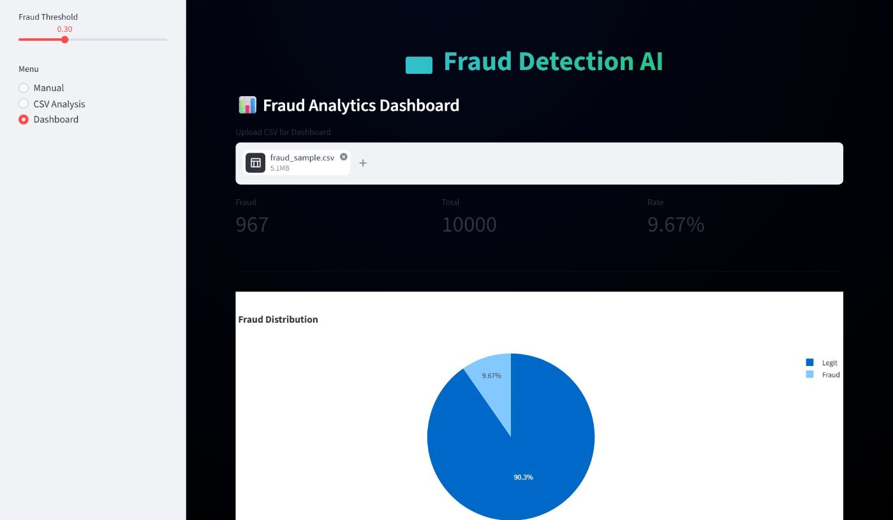
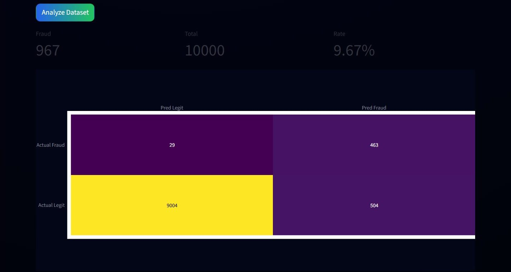

# 💳 Credit Card Fraud Detection

Detects fraudulent card transactions with machine learning, and lets an analyst check transactions in a
Streamlit dashboard: one at a time, or a whole CSV with a confusion matrix, charts and a PDF report.



## Results

Trained on the [Kaggle credit card fraud dataset](https://www.kaggle.com/datasets/mlg-ulb/creditcardfraud):
284,807 transactions, of which only 492 (0.17%) are fraud. Scores are on a stratified 20% test split
(56,962 transactions, 98 frauds) that the models never trained on.

| Model | Precision | Recall | F1 | ROC-AUC |
|---|---|---|---|---|
| Logistic regression, class-weighted (used by the app) | 0.06 | **0.92** | 0.11 | **0.97** |
| Neural network (Keras, 32-16-1) | **0.82** | 0.77 | **0.79** | 0.96 |

The logistic regression is tuned to miss as few frauds as possible: it catches 90 of the 98 test frauds,
at the cost of many false alarms. The neural network is far more precise but misses more. The app's
threshold slider moves along that trade-off.



*CSV analysis of a 10,000-transaction demo sample containing all 492 frauds (463 caught). The sample overlaps the
training data, so it shows how the app works; the table above is the honest test score.*

## Run it

```bash
pip install -r requirements.txt
# put creditcard.csv (from the Kaggle link above) in this folder, then:
python train_model.py      # trains both models, prints their scores, saves model.pkl, scaler.pkl, ann_model.h5
streamlit run app.py       # the dashboard
python test.py             # one example prediction from the command line
```

The trained `model.pkl`, `scaler.pkl` and `ann_model.h5` are included, so the app runs without retraining.

## Known limitations

- **Manual check** fills in only Amount and Time and leaves the 28 anonymised features (V1 to V28) at
  zero, so its score is a rough illustration, not a real verdict. CSV analysis uses every feature.
- Amounts in the dataset are in euros (the app labels them ₹).
